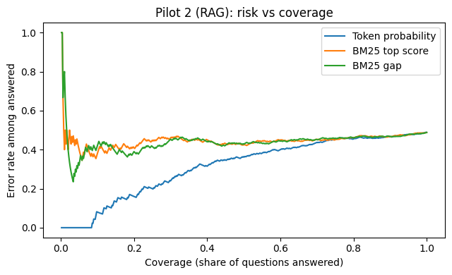

# Does an LLM's confidence predict when it is wrong?

Two small pilots for my PhD proposal on runtime monitoring of LLMs in medical decision support.

**Setup (both pilots):** the same 500 PubMedQA questions, Qwen2.5-7B-Instruct in 4-bit on Google Colab (T4 GPU).

## Pilot 1: correct abstract given
Notebook: `PhD_Pilot_LLM_Confidence.ipynb`
- Accuracy: 46%
- When the model answered yes or no, it was right 90% of the time (199 of 222)
- It answered "maybe" 278 times when only 40 questions needed it; only 32 were correct
- AUROC for spotting wrong answers: 0.58 (token probability), 0.51 (agreement across 10 samples)
- Answers it was over 90% sure of were correct only 48% of the time
- Only the 40 most confident answers (8%) were all correct; after that the error rate rose quickly to about 54%

## Pilot 2: retrieval added (RAG with PyTerrier)
Notebook: `PhD_Pilot2_RAG_PyTerrier.ipynb`

All 1,000 PubMedQA abstracts indexed with PyTerrier (BM25); the model answers from the top 3 retrieved abstracts.
- The question's own abstract was ranked first 95% of the time (top 3: 98%)
- Accuracy: 51%
- When retrieval missed the right abstract (24 questions), accuracy fell to 29%
- It still answered "maybe" 227 times when only 40 questions needed it
- AUROC for spotting wrong answers: 0.68 (token probability), 0.57 (BM25 score)

**Takeaway:** neither the model's confidence nor the retrieval score is enough on its own, and errors cluster where the evidence is missing. This motivates checking each answer against the retrieved evidence.

**Limits:** small corpus (1,000 abstracts, so retrieval is easier than real PubMed search), one model, one prompt, 4-bit compression.
