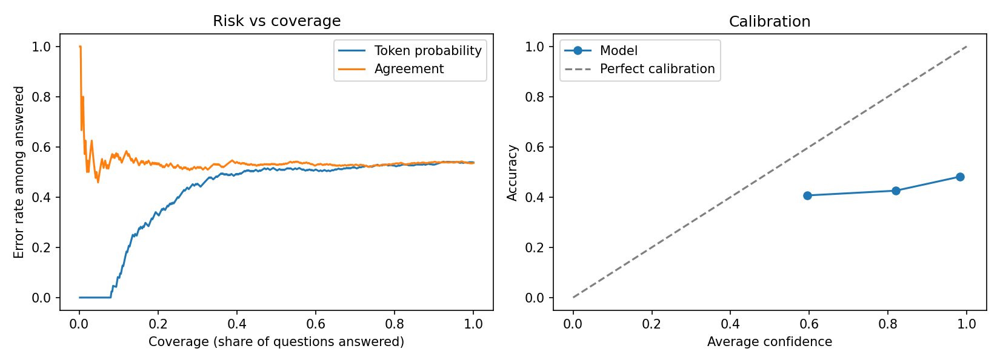

# Does an LLM's confidence predict when it is wrong?

A small pilot for my PhD proposal on runtime monitoring of LLMs in medical decision support.

**Setup:** 500 PubMedQA questions (with abstracts), Qwen2.5-7B-Instruct in 4-bit on Google Colab (T4 GPU).
Two confidence signals: the probability of the answer word, and agreement across 10 sampled answers.

**Results**
- Accuracy: 46%
- When the model answered yes or no, it was right 90% of the time (199 of 222)
- It answered "maybe" 278 times when only 40 questions needed it; only 32 were correct
- AUROC for spotting wrong answers: 0.58 (token probability), 0.51 (agreement)
- Answers it was over 90% sure of were correct only 48% of the time
- Only the 40 most confident answers (8%) were all correct; after that the error rate rose quickly to about 54%

**Takeaway:** the model's own confidence did not reliably flag its errors. This motivates adding a check against the retrieved evidence.

**Limits:** one model, one prompt, 4-bit compression. Next step: compare other models and prompts.

